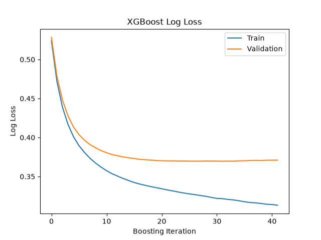
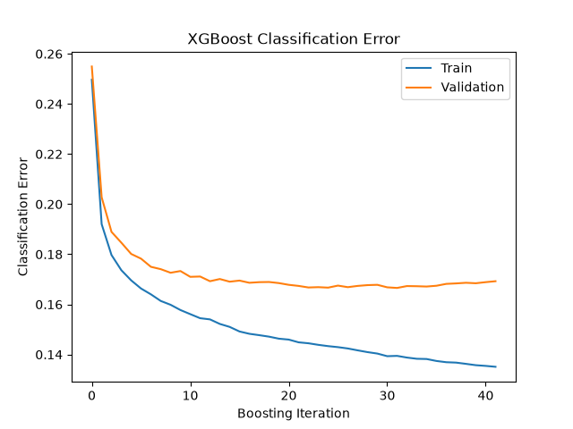

# Work Package 2: Baseline Modeling, Evaluation Setup & Serialization

## 1. Objective
Work Package 2 aims to establish an initial XGBoost classification model for predicting student dropout risk using the preprocessed, encoded, and segmented datasets produced in Work Package 1. The baseline model serves as a benchmark for subsequent hyperparameter tuning and model evaluation.

## 2. Dataset Description
The preprocessed dataset contains 100,000 student records with 54 encoded input features. The dataset was divided into training, validation, and testing subsets.

Training: 64,000 (64%)
Validation: 16,000(16%)
Testing: 20,000 (20%)

Only the training and validation datasets were used in Work Package 2. The testing dataset was reserved for final model evaluation.

### Class Distribution

Class: 0
Training Count: 43,518
Training Percentage: 67.9969%
Validation Count: 10,879 
Validation Percentage: 67.9938% 

Class: 1
Training Count: 20,482
Training Percentage: 32.0031% 
Validation Count: 5,121  
Validation Percentage: 32.0063% 

The training and validation datasets maintained the approximately 32% minority class distribution.

## 3. Baseline Modeling
Following Chapter 4, Section 4.4 of Brownlee (2018), the baseline classification model was initialized using the XGBClassifier class and trained using the fit() method.

The major model hyperparameters were retained at their default values to establish an initial benchmark for subsequent hyperparameter tuning in Work Package 3.

## 4. Evaluation Setup and Early Stopping
Following Chapter 10, Sections 10.2–10.4, both the training and validation datasets were supplied through the eval_set parameter.

The following evaluation metrics were monitored throughout the boosting process:

- Classification error
- Logarithmic loss

Early stopping was configured with a patience of 10 consecutive boosting rounds without improvement in validation log loss.

The validation dataset was placed last in the evaluation set, while log loss was placed last in the evaluation metric list to ensure that early stopping monitored validation log loss.

## 5. Baseline Model Results
Validation Accuracy: 83.34%
Best Validation Log Loss: 0.369669 
Best Iteration (Zero-based): 31 
Stopping Iteration (Zero-based): 41
Total Boosting Rounds Executed: 42 
Early Stopping Patience: 10 
Loaded Model Accuracy: 83.34% 

The lowest validation log loss was obtained at iteration 31. Training terminated at iteration 41 after ten consecutive iterations failed to improve upon the best recorded validation log loss.

## 6. Learning Curve Analysis
### 6.1 Log Loss

The training and validation log loss initially decreased as the model learned patterns from the dataset. However, the validation log loss eventually stabilized and slightly increased, while the training log loss continued decreasing.

This divergence indicates the onset of overfitting and demonstrates the importance of early stopping.

### 6.2 Classification Error

Both training and validation classification errors initially decreased. As training progressed, the validation classification error stabilized at approximately 16.7%, while the training classification error continued decreasing.

The increasing difference between training and validation performance suggests diminishing improvements in generalization.

## 7. Model Serialization

Following Chapter 8, Section 8.2, the trained baseline XGBoost model was serialized using the Joblib library and saved as:

`models/xgboost_baseline.joblib`

The serialized model was subsequently loaded using joblib.load() and evaluated using the validation dataset.

The loaded model achieved the same validation accuracy of 83.34%. Additionally, all validation predictions were verified to be identical to those produced by the original model, confirming successful serialization.

## 8. Implementation Adaptations
The implementation was adapted from Brownlee (2018) to accommodate the existing project structure and XGBoost version 3.4.1.

The following adaptations were applied:

- Used pandas to load the existing preprocessed CSV files.
- Utilized the fixed dataset partitions established in WP1.
- Used the validation dataset instead of the reserved testing dataset during training evaluation.
- Specified evaluation metrics and early stopping parameters in the XGBClassifier constructor for compatibility with the installed XGBoost version.
- Imported Joblib directly.
- Exported learning curves, training history, and baseline performance results.

## 9. Deliverables
Baseline XGBoost implementation: src/baseline_model.py 
Serialized baseline model: models/xgboost_baseline.joblib
Log loss learning curve: performances/xgboost_logloss.png
Classification error learning curve: performances/xgboost_error.png 
Per-iteration performance metrics: performances/xgboost_training_history.csv
Baseline performance summary: performances/xgboost_baseline_results.csv
WP2 methodology and results: documentation/wp2_documentation.md
Updated project dependencies: requirements.txt

## 10. Conclusion
Work Package 2 successfully established a baseline XGBoost classification model with a validation accuracy of 83.34% and a minimum validation log loss of 0.369669.

The evaluation setup enabled continuous monitoring of model performance, while early stopping limited further training when validation performance ceased to improve. Successful model serialization ensures that the trained baseline model can be reused for subsequent work packages.

These results represent validation performance rather than final test performance and will serve as a benchmark for subsequent model optimization.

## Reference

Brownlee, J. (2018). *XGBoost with Python: Gradient boosted trees with XGBoost and scikit-learn*. Machine Learning Mastery.

- Chapter 4: Develop Your First XGBoost Model in Python with scikit-learn, pp. 18–22.
- Chapter 8: Save and Load Trained XGBoost Models, pp. 40–43.
- Chapter 10: Monitor Training Performance and Early Stopping, pp. 50–57.

## RAW RESULTS FOR REFERENCE:
python src/baseline_model.py
Training features: (64000, 54)
Training labels: (64000,)
Validation features: (16000, 54)
Validation labels: (16000,)

Training Class Distribution:
dropout
0    43518
1    20482
Name: count, dtype: int64

Validation Class Distribution:
dropout
0    10879
1     5121
Name: count, dtype: int64

Training Class Percentage:
dropout
0    67.996875
1    32.003125
Name: proportion, dtype: float64

Validation Class Percentage:
dropout
0    67.99375
1    32.00625
Name: proportion, dtype: float64
[0]     validation_0-error:0.24967      validation_0-logloss:0.52401    validation_1-error:0.25494  validation_1-logloss:0.52856
[1]     validation_0-error:0.19202      validation_0-logloss:0.47155    validation_1-error:0.20275  validation_1-logloss:0.47846
[2]     validation_0-error:0.17970      validation_0-logloss:0.43896    validation_1-error:0.18894  validation_1-logloss:0.44805
[3]     validation_0-error:0.17364      validation_0-logloss:0.41687    validation_1-error:0.18463  validation_1-logloss:0.42782
[4]     validation_0-error:0.16958      validation_0-logloss:0.40094    validation_1-error:0.18013  validation_1-logloss:0.41348
[5]     validation_0-error:0.16633      validation_0-logloss:0.38954    validation_1-error:0.17825  validation_1-logloss:0.40365
[6]     validation_0-error:0.16402      validation_0-logloss:0.38076    validation_1-error:0.17500  validation_1-logloss:0.39655
[7]     validation_0-error:0.16137      validation_0-logloss:0.37335    validation_1-error:0.17406  validation_1-logloss:0.39090
[8]     validation_0-error:0.15984      validation_0-logloss:0.36723    validation_1-error:0.17263  validation_1-logloss:0.38687
[9]     validation_0-error:0.15775      validation_0-logloss:0.36211    validation_1-error:0.17331  validation_1-logloss:0.38321
[10]    validation_0-error:0.15611      validation_0-logloss:0.35747    validation_1-error:0.17100  validation_1-logloss:0.38050
[11]    validation_0-error:0.15448      validation_0-logloss:0.35357    validation_1-error:0.17112  validation_1-logloss:0.37814
[12]    validation_0-error:0.15402      validation_0-logloss:0.35050    validation_1-error:0.16925  validation_1-logloss:0.37668
[13]    validation_0-error:0.15220      validation_0-logloss:0.34750    validation_1-error:0.17012  validation_1-logloss:0.37509
[14]    validation_0-error:0.15102      validation_0-logloss:0.34489    validation_1-error:0.16906  validation_1-logloss:0.37409
[15]    validation_0-error:0.14919      validation_0-logloss:0.34233    validation_1-error:0.16950  validation_1-logloss:0.37306
[16]    validation_0-error:0.14827      validation_0-logloss:0.34041    validation_1-error:0.16862  validation_1-logloss:0.37204
[17]    validation_0-error:0.14772      validation_0-logloss:0.33870    validation_1-error:0.16887  validation_1-logloss:0.37155
[18]    validation_0-error:0.14713      validation_0-logloss:0.33714    validation_1-error:0.16894  validation_1-logloss:0.37108
[19]    validation_0-error:0.14631      validation_0-logloss:0.33569    validation_1-error:0.16850  validation_1-logloss:0.37054
[20]    validation_0-error:0.14595      validation_0-logloss:0.33435    validation_1-error:0.16781  validation_1-logloss:0.37023
[21]    validation_0-error:0.14486      validation_0-logloss:0.33286    validation_1-error:0.16737  validation_1-logloss:0.37006
[22]    validation_0-error:0.14448      validation_0-logloss:0.33154    validation_1-error:0.16675  validation_1-logloss:0.37006
[23]    validation_0-error:0.14386      validation_0-logloss:0.33018    validation_1-error:0.16687  validation_1-logloss:0.36996
[24]    validation_0-error:0.14334      validation_0-logloss:0.32887    validation_1-error:0.16669  validation_1-logloss:0.36991
[25]    validation_0-error:0.14294      validation_0-logloss:0.32779    validation_1-error:0.16750  validation_1-logloss:0.36981
[26]    validation_0-error:0.14241      validation_0-logloss:0.32679    validation_1-error:0.16687  validation_1-logloss:0.36971
[27]    validation_0-error:0.14166      validation_0-logloss:0.32567    validation_1-error:0.16737  validation_1-logloss:0.36976
[28]    validation_0-error:0.14095      validation_0-logloss:0.32467    validation_1-error:0.16769  validation_1-logloss:0.36995
[29]    validation_0-error:0.14037      validation_0-logloss:0.32322    validation_1-error:0.16781  validation_1-logloss:0.36996
[30]    validation_0-error:0.13933      validation_0-logloss:0.32194    validation_1-error:0.16681  validation_1-logloss:0.36980
[31]    validation_0-error:0.13945      validation_0-logloss:0.32164    validation_1-error:0.16656  validation_1-logloss:0.36967
[32]    validation_0-error:0.13878      validation_0-logloss:0.32064    validation_1-error:0.16731  validation_1-logloss:0.36980
[33]    validation_0-error:0.13830      validation_0-logloss:0.32005    validation_1-error:0.16725  validation_1-logloss:0.36974
[34]    validation_0-error:0.13820      validation_0-logloss:0.31897    validation_1-error:0.16712  validation_1-logloss:0.37013
[35]    validation_0-error:0.13742      validation_0-logloss:0.31768    validation_1-error:0.16744  validation_1-logloss:0.37022
[36]    validation_0-error:0.13692      validation_0-logloss:0.31672    validation_1-error:0.16819  validation_1-logloss:0.37055
[37]    validation_0-error:0.13677      validation_0-logloss:0.31626    validation_1-error:0.16837  validation_1-logloss:0.37068
[38]    validation_0-error:0.13627      validation_0-logloss:0.31549    validation_1-error:0.16862  validation_1-logloss:0.37055
[39]    validation_0-error:0.13573      validation_0-logloss:0.31446    validation_1-error:0.16844  validation_1-logloss:0.37087
[40]    validation_0-error:0.13545      validation_0-logloss:0.31412    validation_1-error:0.16887  validation_1-logloss:0.37100
[41]    validation_0-error:0.13509      validation_0-logloss:0.31325    validation_1-error:0.16925  validation_1-logloss:0.37103

Baseline XGBoost Results
Accuracy: 83.34%
Best Iteration: 31
Best Validation Log Loss: 0.36966898318913444

Saved model to: models/xgboost_baseline.joblib
Loaded model from: models/xgboost_baseline.joblib
Loaded Model Accuracy: 83.34%